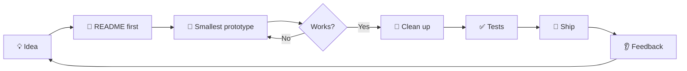
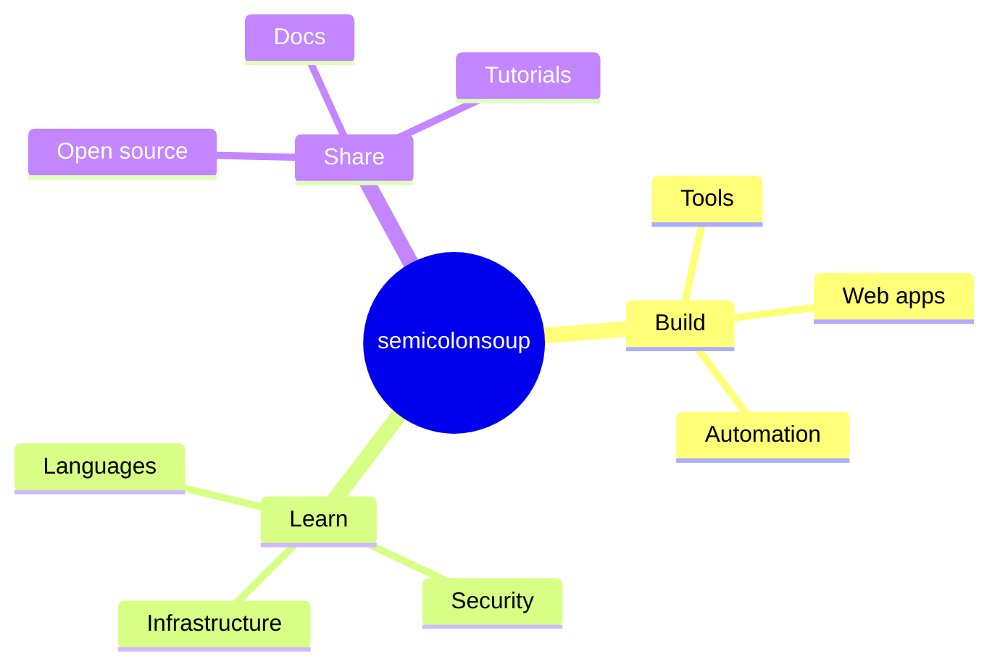

<div align="center">

```
        ( (
         ) )
      .........
      |       |]
      \       /
       `-----'
```

# 🍜 semicolonsoup

### *Stirring code until it tastes right.*

**Developer building open-source tools, web apps and WordPress automation with JavaScript, TypeScript, Python and PHP.**


[Menu](#the-menu) · [Pantry](#the-pantry) · [Kitchen rules](#kitchen-rules) · [Recipes](#recipe-cards) · [FAQ](#faq) · [Secret menu](#secret-menu)

</div>

---

<a id="table-of-contents"></a>

##  🧾 Table of contents

- [🍜 semicolonsoup](#-semicolonsoup)
    - [*Stirring code until it tastes right.*](#stirring-code-until-it-tastes-right)
  - [🧾 Table of contents](#-table-of-contents)
  - [👋 Order up](#-order-up)
  - [🍽 The menu](#-the-menu)
  - [🥄 The pantry](#-the-pantry)
    - [Languages](#languages)
    - [Frameworks and runtimes](#frameworks-and-runtimes)
    - [Tools](#tools)
    - [Skill levels (honest edition)](#skill-levels-honest-edition)
  - [📜 Kitchen rules](#-kitchen-rules)
  - [🧑‍🍳 Recipe cards](#-recipe-cards)
  - [🗺 Kitchen layout](#-kitchen-layout)
  - [🔥 Currently simmering](#-currently-simmering)
  - [🧂 Tasting notes](#-tasting-notes)
  - [📚 Cookbook](#-cookbook)
  - [🐚 Shell aliases](#-shell-aliases)
  - [🥣 Soup of the day](#-soup-of-the-day)
  - [🩺 Health inspection](#-health-inspection)
  - [🤝 Contributing](#-contributing)
  - [❓ FAQ](#-faq)
  - [🕵️ Secret menu](#️-secret-menu)
  - [🛣 Roadmap](#-roadmap)
  - [📓 Changelog](#-changelog)
    - [\[Unreleased\]](#unreleased)
    - [\[1.0.0\] - 2026-11-02](#100---2026-11-02)
  - [📬 Contact](#-contact)
    - [🍜 Thanks for stopping by](#-thanks-for-stopping-by)

---

<a id="order-up"></a>

##  👋 Order up

Welcome to the kitchen.

I'm a software developer who builds small open-source tools, web applications and WordPress plugins and automation. I believe software should be **warm, simple and easy to digest**: tools that do one thing well, code that reads like a recipe, and commit histories that tell a story.

This account is deliberately anonymous. The work speaks, the ladle stays hidden.

```js
const me = {
  handle: "semicolonsoup",
  kitchen: "the internet",
  specialty: ["open-source tools", "automation", "web apps", "WordPress", "TypeScript"],
  philosophy: "ship it, season it, serve it again",
  favoritePunctuation: ";",
};
```

---

<a id="the-menu"></a>

##  🍽 The menu

| Course | What it means | Examples |
|---|---|---|
| 🥗 **Starters** | Small scripts and quick utilities | CLI helpers, one-file tools |
| 🍲 **Mains** | Full apps and services | Web apps, APIs, dashboards |
| 🍰 **Desserts** | Polish and delight | UI details, animations, docs |
| 🍵 **Drinks** | Tooling and automation | Build scripts, CI, dotfiles |
| 🧂 **Seasoning** | Libraries and plugins | Reusable modules, WordPress add-ons |

> New dishes appear in my pinned repositories. Everything pinned has a README, a license and setup steps.

---

<a id="the-pantry"></a>

##  🥄 The pantry

### Languages


### Frameworks and runtimes


### Tools


### Skill levels (honest edition)

| Ingredient | Comfort | Notes |
|---|---|---|
| JavaScript / TypeScript | 🍲🍲🍲🍲 | Daily driver |
| Python | 🍲🍲🍲 | Scripts, automation, glue |
| PHP / WordPress | 🍲🍲🍲🍲 | Themes, plugins, hosting, hardening |
| Shell | 🍲🍲🍲 | Enough to be dangerous |
| DevOps | 🍲🍲 | Learning in public |
| Design | 🍲🍲 | I know what I like |

---

<a id="kitchen-rules"></a>

##  📜 Kitchen rules

1. **Taste as you go.** Run the code early and often.
2. **Clean as you cook.** Refactor in small steps, not in a panic.
3. **Mise en place.** Set up tooling, linting and tests before building.
4. **No mystery ingredients.** Every dependency earns its place.
5. **Label everything.** Names and commit messages should explain themselves.
6. **Don't over-stir.** Stop optimizing when it's good enough.
7. **Serve hot.** Ship small, ship often.
8. **Share the recipe.** Document it so the next person can cook it too.
9. **Respect the guests.** Accessibility and privacy are not optional extras.
10. **End your statements properly.** `;` ✨

---

<a id="recipe-cards"></a>

##  🧑‍🍳 Recipe cards

<details>
<summary><b>🍳 Starting a new project</b></summary>

1. Write the problem in one sentence in the README first
2. Create the repo with a license and `.gitignore`
3. Add a formatter, a linter and a simple test
4. Make the smallest thing that works
5. Commit. Push. Repeat.

</details>

<details>
<summary><b>🐛 Fixing a bug</b></summary>

1. Reproduce it reliably
2. Write a failing test
3. Find the cause (not just the symptom)
4. Fix it with the smallest change
5. Confirm the test passes and nothing else broke
6. Write a commit message that explains *why*

</details>

<details>
<summary><b>🚢 Shipping a release</b></summary>

1. Update the changelog
2. Bump the version
3. Run the full test suite
4. Tag the release
5. Write human-friendly release notes
6. Watch the logs for the first hour

</details>

<details>
<summary><b>🔐 Hardening a website</b></summary>

1. Keep core, themes, plugins and PHP updated
2. Use unique, long passwords and 2FA
3. Limit login attempts and hide default admin URLs
4. Put a CDN or firewall in front
5. Back up before every change
6. Test the restore, not just the backup

</details>

<details>
<summary><b>📝 Writing a good commit message</b></summary>

```
type(scope): short summary in imperative mood

Longer explanation of what changed and why.
Mention trade-offs or follow-ups if there are any.
```

Common types: `feat`, `fix`, `docs`, `refactor`, `test`, `chore`.

</details>

<details>
<summary><b>🔍 Reviewing a pull request</b></summary>

1. Read the description first
2. Run it locally if it matters
3. Comment on behavior and risk before style
4. Praise something specific
5. Approve or request changes clearly

</details>

---

<a id="kitchen-layout"></a>

##  🗺 Kitchen layout





---

<a id="currently-simmering"></a>

##  🔥 Currently simmering

- [ ] 🧩 A small open-source utility (repo coming soon)
- [ ] 🛡 Notes on hardening WordPress sites
- [ ] ⚡ Speed experiments with Bun vs pnpm vs npm
- [ ] 📖 Writing better READMEs
- [x] 🍜 Setting up this profile

---

<a id="tasting-notes"></a>

##  🧂 Tasting notes

A running log of things I've learned. Newest first.

| Date | Note |
|---|---|
| 2026-11 | Bun installs are fast, but test real dependency trees before switching |
| 2026-11 | A profile README repo must match your username exactly |
| 2026-10 | Keep `PHP` patched. Security fixes land often |
| 2026-10 | Hide login URLs help, but real security is updates and strong auth |
| 2026-10 | Cache plugins: pick one, don't stack them |

---

<a id="cookbook"></a>

##  📚 Cookbook

Resources I'd point a friend to:

- **MDN Web Docs**: the reference for the web platform
- **The Pragmatic Programmer**: habits for good craft
- **Pro Git**: free, thorough, and readable
- **Refactoring** (Fowler): small steps toward better code
- **OWASP Top 10**: the security basics everybody should know
- **Conventional Commits**: a simple standard for messages
- **Keep a Changelog**: how to write release notes humans read

---

<a id="shell-aliases"></a>

##  🐚 Shell aliases

```bash
# kitchen shortcuts
alias gs='git status -sb'
alias gl='git log --oneline --graph --decorate -20'
alias gco='git checkout'
alias gcb='git checkout -b'
alias gp='git push'
alias gpl='git pull --rebase'
alias ..='cd ..'
alias ll='ls -lah'
alias serve='python3 -m http.server 8000'
alias stir='git pull --rebase && echo "stirred 🥄"'
alias taste='npm test'
alias plate='git push && echo "plated 🍽"'
```

---

<a id="soup-of-the-day"></a>

##  🥣 Soup of the day

A little ritual: each day has a soup and a coding mantra.

| Day | Soup | Mantra |
|---|---|---|
| Mon | 🍅 Tomato | Start small |
| Tue | 🍜 Ramen | Keep it simple |
| Wed | 🥕 Carrot ginger | Refactor something |
| Thu | 🍲 Lentil | Write tests |
| Fri | 🌽 Corn chowder | Ship it |
| Sat | 🥣 Miso | Explore and tinker |
| Sun | 🍵 Broth | Rest and reflect |

<!--SOUP--> Today's soup: **Broth**

---

<a id="health-inspection"></a>

##  🩺 Health inspection

<div align="center">


</div>

---

<a id="contributing"></a>

##  🤝 Contributing

Welcome in. Here's how to help on any of my projects:

1. 🍴 Fork the repo
2. 🌿 Create a branch: `git checkout -b feat/tasty-thing`
3. ✍️ Make your change with a clear commit message
4. 🧪 Run tests and the linter
5. 📬 Open a pull request that explains *what* and *why*

**Good first contributions:** typo fixes, clearer docs, extra tests, small bug fixes.

**Etiquette:** be kind, be specific, assume good intent. No one gets roasted in this kitchen.

---

<a id="faq"></a>

##  ❓ FAQ

<details>
<summary><b>Who are you?</b></summary>
A cook who prefers the food to be the story. 🍜
</details>

<details>
<summary><b>Why "semicolonsoup"?</b></summary>
Because a semicolon ends a statement without ending the sentence, and soup is what you make when you keep going. Also it sounded fun.
</details>

<details>
<summary><b>Do you take freelance or paid work through this account?</b></summary>
This profile is for projects and learning. Open an issue on a relevant repo if you want to discuss something.
</details>

<details>
<summary><b>Tabs or spaces?</b></summary>
Whatever the project's formatter says. 🥄
</details>

<details>
<summary><b>Semicolons in JavaScript: yes or no?</b></summary>
Look at the username.
</details>

<details>
<summary><b>Can I use your code?</b></summary>
Check each repo's license. Most are permissive. Attribution is appreciated.
</details>

<details>
<summary><b>Do you accept sponsorships?</b></summary>
Not at the moment. A star, a bug report or a pull request is plenty. ⭐
</details>

---

<a id="secret-menu"></a>

##  🕵️ Secret menu

<details>
<summary>🔓 Click if you're hungry for easter eggs</summary>

```
 ____   ___  _   _ ____
/ ___| / _ \| | | |  _ \
\___ \| | | | | | | |_) |
 ___) | |_| | |_| |  __/
|____/ \___/ \___/|_|
```

- 🥄 There are exactly **zero** missing semicolons in this README.
- 🧪 `console.log("soup")` is a valid unit test if you believe hard enough.
- 🐛 Every bug is just an unlisted ingredient.
- 🍜 The noodles are `null`. The broth is `undefined`.
- 🏆 You found the secret menu. Have a star ⭐ on the house.

```python
def make_soup(ingredients):
    pot = []
    for item in ingredients:
        pot.append(item)  # stir
    return ";".join(pot) + ";"

print(make_soup(["code", "coffee", "curiosity"]))
# code;coffee;curiosity;
```

</details>

---

<a id="roadmap"></a>

##  🛣 Roadmap

| Quarter | Goal |
|---|---|
| 🥇 Now | Polish the profile, publish first open-source tool |
| 🥈 Next | Write docs and a few short how-to guides |
| 🥉 Later | Grow a small community around the projects |
| 🌟 Someday | A fully-fledged recipe book of reusable modules |

---

<a id="changelog"></a>

##  📓 Changelog

### [Unreleased]
- Everything is better with soup

### [1.0.0] - 2026-11-02
- 🍜 Opened the kitchen
- 🎨 Added a profile README
- 🧂 Added far too many sections

---

<a id="contact"></a>

##  📬 Contact

This is an anonymous profile, so the best way to reach me is through GitHub itself:

- 🐛 Open an **issue** on a relevant repository
- 💬 Start a **discussion** where discussions are enabled
- 🔀 Send a **pull request** (the best hello of all)

---

<div align="center">

### 🍜 Thanks for stopping by

*May your builds be green and your soup be hot.*

<sub>`;` every good program ends somewhere</sub>


</div>